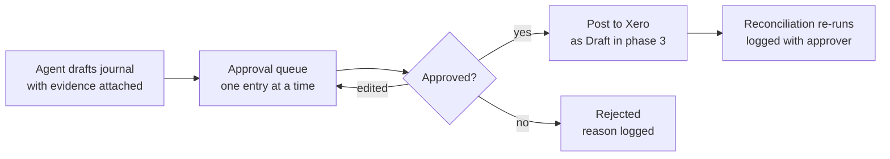
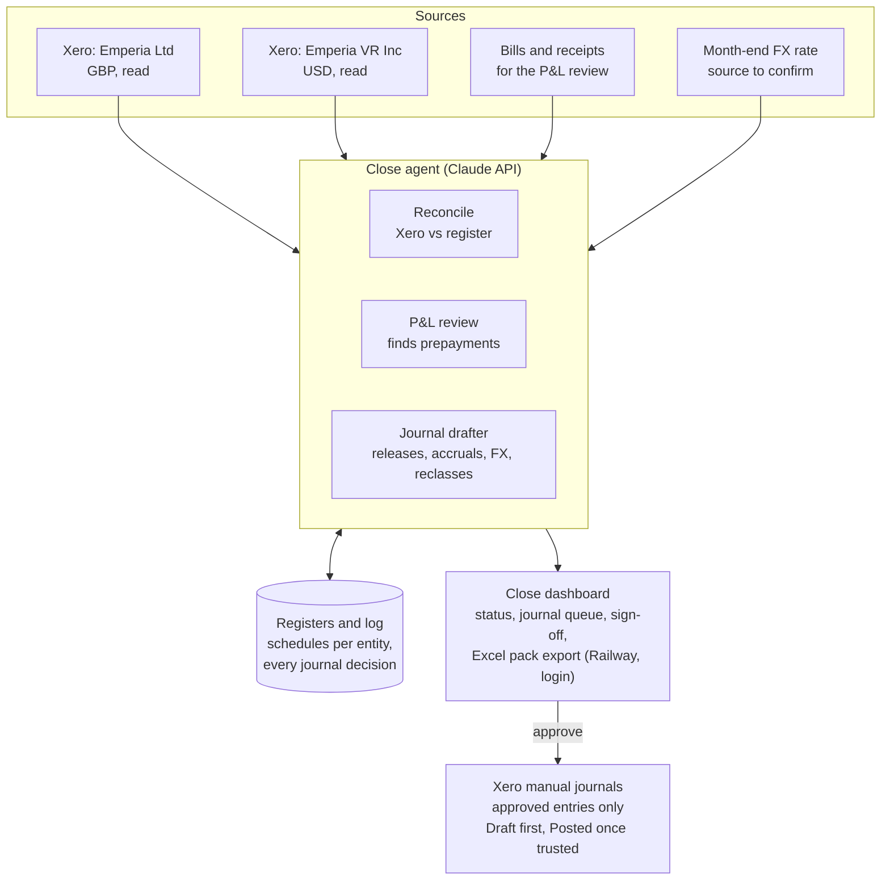

# Emperia Month-End Close Agent — Scoping

Oct 30, 2026 · Reece Grindle · Live version: https://claude.ai/artifact/Atta4q32vmrMFbc5AuR9Hz

## Summary

We're building a month-end close agent with a review dashboard for Emperia's two Xero entities, Emperia Ltd (GBP) and Emperia VR Inc (USD). It replaces the analyst's manual workbook roll-forward. Nothing posts to Xero without a person approving it.

The agent has three jobs:

1. **Reconcile the balance sheet.** Pull each balance sheet account from Xero at month end. Rebuild the supporting schedule (aged lists, prepayments, accruals, deferred and accrued income, deposits, intercompany, VAT, fixed assets). Flag every difference.
2. **Review P&L coding for prepayments.** Scan the month's bills and spend coded to the P&L. Flag anything whose service period runs past month end. Propose the prepayment and its release schedule.
3. **Propose correcting journals.** Draft the journals needed to clear the breaks: prepayment releases, accrual roll-forwards, deferred revenue releases, intercompany FX revaluation and miscoding fixes. Each one goes into an approval queue, one entry at a time, before it reaches Xero.

The output each month is a signed-off reconciliation pack per entity, matching what the analyst produces today, plus a log of every journal proposed, approved, rejected or edited.

## How month end runs today

Each entity has its own workbook. A Xero balance sheet is pasted in. Each account is matched to a supporting schedule, and the difference, a Reconciled tick and a comment are recorded. The Ltd workbook is mature (35 tabs, a BS Review index). The Inc workbook is lighter (9 tabs, the Xero BS tab is the index) and several tabs haven't been rolled forward.

| Account | Ltd (GBP) | Inc (USD) | How it's reconciled | Automatable |
| --- | --- | --- | --- | --- |
| Bank and cards | 6 accounts | 4 accounts | Balance agreed to statement | Yes: Xero bank statement balance vs ledger |
| Trade debtors / AR | Aged list | Aged list (stale, Jul-26) | Aged receivables total vs ledger | Yes |
| Trade creditors / AP | Aged list | Aged list (stale, May-26) | Aged payables total vs ledger | Yes |
| Prepayments | Schedule, monthly release | Schedule, event-date release | Invoice, service period, monthly release | Yes, core module |
| Accruals | Schedule | None | Supplier, monthly roll-forward | Yes, with analyst input |
| Accrued income | Schedule | Schedule | Contract, revenue period | Partly: needs contract dates |
| Deferred income | Schedule | Schedule | Invoice, revenue period, release | Yes, once contracts are loaded |
| Deposits | 2 schedules | Comment only | Listing of deposits paid and refunded | Yes, as a maintained register |
| Intercompany | Full ledger reco with FX | Cross-refers to Ltd | USD balance in both books, Ltd revalued at month-end rate | Yes, core module |
| Fixed assets | FAR vs TB | None | Register NBV vs ledger | Yes: Xero fixed asset register |
| VAT | Return vs books by quarter | n/a | Filed returns vs Xero VAT reports | Partly |
| Payroll liabilities | Comment only | n/a | Agreed to the month's liability | Yes, if payroll reports are available |
| Corporation tax | Schedule | Unreconciled | R&D claim and payments | Manual, review only |
| Directors' loan | Ledger listing | Unreconciled | Movements listing | Yes: list movements, flag new ones |
| Share capital and premium | Cap table vs ledger | n/a | Shares × nominal vs ledger | Review only, changes rarely |

The pattern is the same for every account: Xero balance, supporting schedule, difference, explanation. That is what the agent automates.

## What the September 2026 workbooks already show

September is the test case. It has one clear correcting journal (£30,571.26 of unposted FX on intercompany), several unreconciled balances, and formula breaks that hide errors. The agent should catch all of these on a first run.

| Entity | Account | Xero | Schedule | Difference | What it is | Agent action |
| --- | --- | --- | --- | --- | --- | --- |
| Ltd | Intercompany – Emperia VR Inc | £2,008,518.66 | £2,039,089.92 | £30,571.26 | Inc owes $2,704,772.24, agreed in both books. At 0.753886 that is £2,039,089.92. Revaluation not posted | Propose: Dr Intercompany, Cr unrealised FX gain, £30,571.26 |
| Inc | Accrued Income | $180,150.71 | $7,794.19 | $172,356.52 | Walmart revenue accrued, to be invoiced in October. Not on the schedule | Add Walmart line to schedule; check reversal in October |
| Ltd | Provision for Corporation Tax | £83,425.27 debit | £0 | £83,425.27 | FY26 R&D claim recognised in Xero; schedule not updated | Flag: schedule needs the FY26 claim |
| Inc | Directors' Loan Account | $84,987.00 debit | None | Unreconciled | Director's personal taxes paid, to be reimbursed | Flag: build a movements schedule |
| Inc | Corporation and state tax | $11,440 debit / $783 | None | Unreconciled | No schedule | Flag |
| Inc | Prepayments – Rose Property Aug rent | Ties at $16,930 | Released twice | $6,759.47 in schedule | Aug rent release shows in both Aug and Sep columns. The balance check formula skips the Sep column, so it shows 0 | Check Xero for a double release |
| Ltd | Prepayments | £10,955.60 | £10,955.51 | £0.09 | Rounding carried since May | Propose a one-off £0.09 clear-down |
| Ltd | Prepayments, Oct column | n/a | n/a | £3,086.83 | Oct balance formula adds back three fully released 2025 invoices (ZenLeads ×2, Later.com) | Not an issue once schedules are rebuilt from data |
| Ltd | Share capital tab | £2,185,584.53 | £3.97 | Broken lookup | Tab looks up the wrong row. BS Review itself ties to within £0.01 | None: agent reads Xero directly |
| Inc | AR and AP tabs | n/a | Jul-26 / May-26 | Not rolled forward | Xero links show #REF! | Agent rebuilds from aged reports each month |
| Inc | Brex primary, Amex card | $26.00 / $18,088.53 | n/a | Not ticked | No statement agreed | Agree to Xero statement balance |
| Ltd | Transferwise GBP / USD | £0.21 / £5.77 | n/a | Not ticked | Dormant accounts | Flag once; suggest close or write-off |

Two things stand out for the design. First, most breaks come from schedules that are rolled forward by hand, not from bookkeeping errors. Second, the Inc workbook's date headers are a year out (Sep-26 is labelled 26/09/2025). Rebuilding schedules from Xero transactions each month removes both problems.

## Proposed design

The agent keeps one register per schedule in its own database, rebuilt from Xero each month rather than rolled forward by hand. Each register produces the expected closing balance, compares it with Xero and proposes the journal to close any gap.

### Module 1: Balance sheet reconciliation

- Pull the trial balance for each entity at month end.
- For each account, run its reconciliation rule (table above): aged reports for AR and AP, statement balance for bank, register for schedules.
- Status per account: Reconciled, Explained difference (with a reason the analyst confirms), or Break.
- Carry explanations forward. If last month's reason still applies to the same amount, pre-fill it for the analyst to confirm.

### Module 2: P&L prepayment review

Every bill, spend money and card transaction coded to the P&L in the month is scored. A line is flagged when any of these hold:

- The invoice or line description states a service period running past month end ("annual", "12 months", "Oct 2026 – Sep 2027", a renewal).
- The supplier has prepaid history on the register (Carta, LastPass, Rebank, ZenLeads, Simply Business, NRF, Shoptalk, Rose Property).
- The account is one where prepayments usually sit (software, insurance, events, rent, travel booked ahead, professional fees on retainer) and the amount is over a threshold.
- The invoice is dated well before the event or service date (Inc's event and travel spend).

For each flag the agent proposes: the prepayment journal (Dr Prepayments, Cr the P&L account), the service start and end dates, and the monthly release schedule. On approval, the line joins the prepayments register and its releases are proposed automatically in later months.

### Module 3: Recurring and correcting journals

From the registers and the reconciliation, the agent drafts:

- Prepayment releases (monthly straight line for Ltd; on the event or travel date for Inc's one-off items).
- Accrual roll-forwards and reversals when the matching bill arrives.
- Deferred revenue releases and accrued income for contracts on the register.
- Intercompany FX revaluation in Ltd.
- Depreciation checks against the fixed asset register.
- Reclasses for miscoded items it finds in the P&L review.

Each draft carries its evidence: the source transaction or attachment, the register line, and the reconciliation it clears.

### Module 4: Dashboard

One close view per entity per month: accounts by status, the journal queue, open questions for the analyst, and a sign-off. Export to the same Excel layout as today so the reviewer and auditors see a familiar pack.

## Two entities and intercompany

The two entities run as separate closes in one app, with intercompany as the step that links them. Ltd must not sign off until the intercompany check passes.

|  | Emperia Ltd | Emperia VR Inc |
| --- | --- | --- |
| Xero organisation | Separate | Separate |
| Currency | GBP | USD |
| Intercompany account | Intercompany – Emperia VR Inc (asset) | Intercompany – Emperia Ltd (liability) |
| Prepayment method | Monthly straight line | Mostly released on the event or travel date |
| Schedules today | Full set | Prepayments, accrued and deferred revenue only |

The intercompany check each month:

1. Read the USD balance in both books. They must agree to the cent (September: $2,704,772.24 in both).
2. List unmatched items: anything in one ledger and not the other, such as a payment Ltd made for Inc not yet recharged.
3. Revalue Ltd's balance at the month-end USD/GBP rate. Propose the FX journal for the movement.

The Xero API does not return historical exchange rates on request. The month-end rate will come from a set source (for example the rate Xero applied, or a published rate the analyst confirms). This needs a decision, below.

Consolidation stays out of scope for now; a combined GBP view can be added later.

## Approvals and controls

Every journal, including recurring releases, needs a person's approval before it reaches Xero.

Before anything posts, the agent checks that debits equal credits, every account code exists and is active, the period is open, and the journal won't push a reconciled account out of balance. Edits keep the original draft and the reason, so the log shows what the agent proposed and what a person changed. Rejected entries are not proposed again unless the underlying data changes.

The agent never edits or deletes existing Xero transactions. Corrections are always a new manual journal, so every change is visible and reversible.

## Technical architecture

RORA's standard agent stack: Claude API for the agent, the Xero API directly, a database for the registers, and a web dashboard on Railway behind a login.

We connect directly to Xero through our own Xero API app rather than the Claude connector, which can't post manual journals. The integration is authorised for both Emperia organisations: read access for reports, transactions and attachments, and manual-journal write access added only at phase 3. The project is fully separate from other RORA clients: its own Xero app, its own credentials and data store, and a startup check that refuses to run against any organisation other than the two Emperia entities.

## Phased rollout

Read-only first, then one write capability at a time, so each new permission is proven before the next is granted. Each phase runs alongside the analyst's workbook until the numbers match for a full month.

1. **Read and reconcile.** Connect both Xero organisations read-only. Load the September schedules as opening registers. Run the October close in parallel with the analyst and compare account by account.
2. **Prepayment review.** Turn on the P&L scan. The agent proposes prepayments; approved ones are posted by the analyst in Xero, not by the agent.
3. **Journals as Draft.** Give the agent manual-journal write access. Approved journals land in Xero as Draft; a person posts them.
4. **Direct posting.** Once a month or two of drafts have gone through without edits, allow approved journals to post directly. Keep Draft for anything over the threshold or outside the standard journal types.
5. **Retire the workbook.** The dashboard export becomes the reconciliation pack.

## Open decisions

- [x] **Xero access.** Decided: connect directly to Emperia's Xero through our own Xero API app, not the Claude connector. Reece to help authorise both Emperia organisations; manual-journal write permission is added at phase 3.
- [ ] **Who approves.** The analyst prepares, you approve? Or a single approver with a value threshold above which a second person signs?
- [ ] **Draft or post.** Should approved journals land in Xero as Draft (posted by a person in Xero) for the first few months, or post directly?
- [ ] **Prepayment threshold.** Minimum amount to treat as a prepayment rather than expense (for example £500 / $500), and whether Inc keeps event-date release or moves to straight line.
- [ ] **FX rate source** for intercompany revaluation.
- [ ] **Source documents.** Are bills captured in Xero with attachments, or through Spendesk or another tool? The P&L review is much stronger when it can read the invoice.
- [ ] **Where the analyst works.** Dashboard only, or a Slack channel as well, for the "close is ready for review" prompt.
- [ ] **Clean-up first.** Fix the September breaks (FX journal, Inc accrued income schedule, CT, DLA) by hand before go-live, or let the agent's first run propose them?
